<p align="center">
  
</p>

<h3 align="center">🎰 welcome to devnull casino 🎰</h3>
<p align="center"><i>the house runs on python. the odds are 6+ years in production.</i></p>

---

### 🎲 chips on the table

```text
BET ▸ python · django · fastapi · postgresql · celery · redis
    ▸ react · next.js · typescript
    ▸ docker · aws ecs · github actions · linux
```

### 💰 paytable

| combo | payout |
|:---:|---|
| 🐍 🐍 🐍 | **Insiders** · core APIs moved from Django views to FastAPI, multi-tenant SaaS |
| ⚡ ⚡ ⚡ | **Binary Studio** · Celery + Redis pipeline, 50k+ tasks/run, 30 min → under 8 min |
| ⚛️ ⚛️ ⚛️ | **Sigma Software** · React component library, new features ~30% faster |
| 🗄️ 🗄️ 🗄️ | **ELEKS** · ERP automation, junior → mid in under 18 months |
| 🎓 🎓 🎓 | **Lviv Polytechnic** · BSc + MSc in Computer Science |
| 🐛 🐛 🐛 | sent to `/dev/null`. no payout. |

### 📜 house rules

1. boring tech is a winning strategy
2. if it's not in a migration, it didn't happen
3. a background job beats a loading spinner
4. no deploys on friday. the house has seen things.
5. multi-tenancy is decided in the data model, not at the bar

### 🎟️ cash out

```text
status   → open to remote full-stack roles (python + react/next.js)
ask me   → django orm, celery, multi-tenant schemas, "why is this query slow"
```

<p align="center">
  <a href="https://www.linkedin.com/in/YOUR-LINKEDIN/">linkedin</a> ·
  <a href="mailto:YOUR@EMAIL">email</a>
</p>

<p align="center"><sub>🎰 the house always wins. bugs go to /dev/null.</sub></p>
